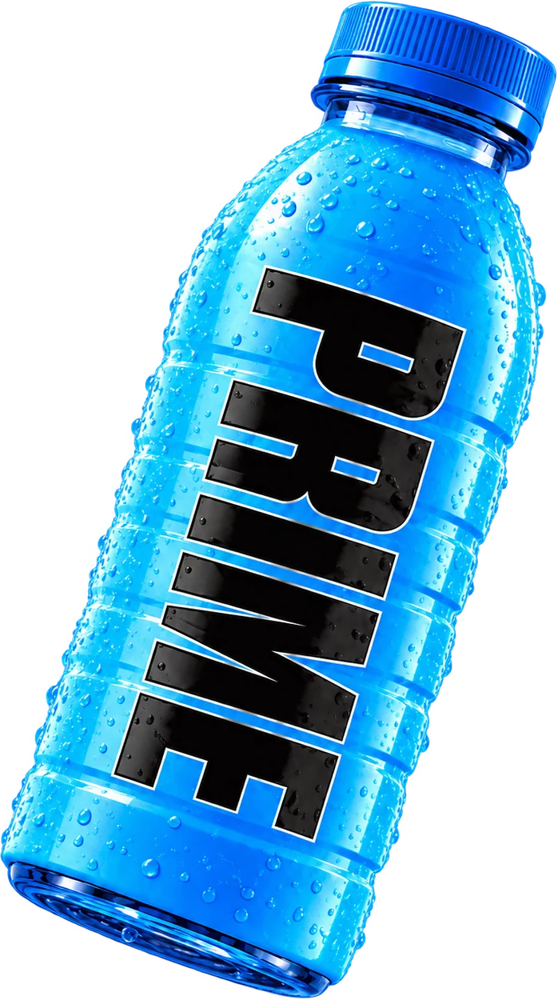

# PRIME Hydration — interactive campaign concept

A three-flavour product hero for Blue Raspberry, Tropical Punch, and Lemon Lime. Each slide combines layered artwork, responsive motion, drag and swipe navigation, and a bold flavour identity.

## Versions

| Version | Stack | Run it |
| --- | --- | --- |
| `index.html` | HTML, CSS, JavaScript | Open directly or run `python -m http.server 5173` |
| [`prime-next/`](prime-next/) | Next.js 16, React 19, Tailwind CSS 4 | `cd prime-next && npm install && npm run dev` |

The Next.js version is the current component-based implementation. Its production build was verified with `npm run build`.

## Design details

- Three distinct colour and artwork systems driven by reusable flavour data
- Layered parallax, animated product elements, and keyboard, click, and swipe controls
- Responsive layouts and reduced-motion consideration
- Optimised WebP assets included so the concepts run without an external image service

This is a frontend campaign concept. Shop and bag controls illustrate the interface and are not connected to a checkout.
